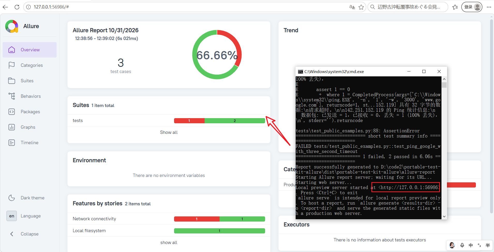

<p align="center">
    <strong>English</strong> ·
    <a href="./README.md">简体中文</a>
</p>

# Portable Python, pytest, and Allure Test Environment

This project builds a portable Windows x64 test package.
The package includes WinPython, locked pytest dependencies, Allure CLI 2.46.1, and Eclipse Temurin JRE 21.0.12.1+1.
Simply copy the folder to run it; Python, Java, and Allure do not need to be installed separately.

| Item | Description |
| --- | --- |
| Target device requirements | Windows x64, `ping.exe`, read access to the `C:\` root directory, and a default system browser |
| Bundled runtimes | Python and Java are included; the target device does not need separate installations of Python, Java, or uv |
| Network requirements | Components must be downloaded when building; ping tests need outbound ICMP; report generation does not need network access |
| Example tests | `test_public_examples.py`: ping Baidu, ping Google with a 3-second timeout, and list the `C:\` root directory |

## Run the Example

Just double-click `run-tests.cmd`; the report will open automatically.


Demo video: [portable-test-kit-allure walkthrough](assets/portable-test-kit-allure_demo_video.mp4)

## Workflow

1. [Build the package](#build-the-package) on the build machine.
2. Copy `dist\portable-test-kit-allure` to the target device and [run the tests](#run-on-the-target-device).
3. To add tests, modify the source as described in [Writing and Selecting Tests](#writing-and-selecting-tests), then rebuild the package.
4. Use [Package Validation](#validate-the-package) to check the build output.

## Build the Package

### Build Machine Requirements

Use an internet-connected Windows x64 build machine and run the following command from the repository root:

```powershell
.\tools\portable-test-env\build.ps1
```

The build script downloads the Python, Allure CLI, and Temurin JRE archives from the locations specified in the manifest and verifies each archive's SHA-256 hash. It downloads the locked pytest wheels and installs them offline into the package. The output directory is `dist\portable-test-kit-allure` under the repository root.

If the output directory already exists, the build is refused by default. To replace it, explicitly pass `-Force`:

```powershell
.\tools\portable-test-env\build.ps1 -Force
```

### Use a Local Cache

If the archives and wheelhouse have already been downloaded locally, pass their paths to avoid downloading them again:

```powershell
.\tools\portable-test-env\build.ps1 `
  -RuntimeArchivePath "C:\cache\WinPython64-3.13.18.0dot.zip" `
  -WheelhousePath "C:\cache\pytest-wheels" `
  -AllureArchivePath "C:\cache\allure-2.46.1.zip" `
  -JavaRuntimeArchivePath "C:\cache\OpenJDK21U-jre_x64_windows_hotspot_21.0.12.1_1.zip"
```

To check build metadata and the SHA-256 hashes of any supplied archives without downloading files or writing to the output directory, run:

```powershell
.\tools\portable-test-env\build.ps1 -ValidateOnly
```

## Run on the Target Device

Copy the package directory to a location writable by the current user on the target device. Open PowerShell or Command Prompt and run the following from the package directory:

```powershell
.\run-tests.cmd
```

### Example Tests

The current examples are in `tests\test_public_examples.py`:

| Test | Description |
| --- | --- |
| `test_ping_baidu` | Pings `www.baidu.com` and checks the exit code and `TTL=` |
| `test_ping_google_with_three_second_timeout` | Pings `www.google.com` with a 3-second reply and process timeout |
| `test_list_c_drive_root_directory` | Lists `C:\`, checking that it is non-empty and contains `Windows` |

The ping tests require outbound ICMP. Google may be blocked on some networks; in that case the test fails and keeps the ping output, without affecting the C: drive test. The examples do not require administrator privileges and do not modify files or system configuration.

### Results and Logs

Each run cleans up the previous managed results, then runs pytest and generates an Allure report. The launcher will still attempt to generate and open the report even if a test fails.

| File or directory | Contents |
| --- | --- |
| `allure-results` | Allure results from the current pytest run |
| `allure-report` | Generated Allure report |
| `logs\pytest.log` | pytest output |
| `logs\allure-generate.log` | Allure report generation log |
| `logs\allure-open.log` | Allure report launch log |

| Situation | Launcher exit code |
| --- | --- |
| pytest runs | Returns the pytest exit code |
| pytest succeeds, but report generation or launch fails | Returns a non-zero exit code |

Allure CLI opens the default system browser and starts a temporary report server on `127.0.0.1`; it does not listen on external network interfaces. Keep the terminal open while viewing the report. Press `Ctrl+C` to stop the server. The next run cleans up and regenerates the report.

## Writing and Selecting Tests

### Python Dependencies

Python packages currently managed by the project dependency files are listed below. `requirements.in` specifies direct dependencies, while `requirements.lock` pins the versions and SHA-256 hashes of the complete dependency tree.

| Type | Package | Version |
| --- | --- | --- |
| Direct dependency | `pytest` | `8.3.2` |
| Direct dependency | `allure-pytest` | `2.16.2` |
| Transitive dependency | `allure-python-commons` | `2.16.2` |
| Transitive dependency | `attrs` | `26.1.0` |
| Transitive dependency | `colorama` | `0.4.6` |
| Transitive dependency | `iniconfig` | `2.3.1` |
| Transitive dependency | `packaging` | `26.3` |
| Transitive dependency | `pluggy` | `1.7.0` |

Allure CLI and the Java JRE are downloaded and packaged as separate runtimes, not as Python packages. Do not add them to `requirements.in`.

When adding a Python dependency, follow these steps:

1. Add the dependency and pin its direct version in `tools\portable-test-env\requirements.in`, for example:

   ```text
   some-package==1.2.3
   ```

2. Regenerate the lock file using the project's configured `pip-tools` environment. The command recorded for the current `requirements.lock` is:

   ```powershell
   pip-compile --generate-hashes --no-index --output-file='tools\portable-test-env\requirements.lock' --strip-extras 'tools\portable-test-env\requirements.in'
   ```

   Do not edit the lock file manually. After generating it, check that the new package and its transitive dependencies have pinned versions and hashes, and that compatible wheels are available for the bundled Python 3.13 on Windows x64. The build downloads wheels only; it does not install source packages.

3. If the test code uses the new package, add or update the relevant tests, then rebuild from the repository root:

   ```powershell
   .\tools\portable-test-env\build.ps1 -Force
   ```

   `-Force` replaces an existing output package. After building, run the validation script from the generated package directory:

   ```powershell
   .\validate-bundle.ps1
   ```

   The package uses its bundled dependencies at runtime and does not download dependencies; the ping tests still require outbound ICMP.

### Add or Modify Tests

Create or modify `test_*.py` files in the source directory `tools\portable-test-env\tests\`. Test function names must begin with `test_`. Put shared fixtures, command-line options, and test configuration in `tests\conftest.py`. Rebuild the package after modifying the source so that the package includes the updated tests.

The default test scope is determined by the `"tests"` argument in `tools\portable-test-env\run_tests.py`. Usually, no changes are needed; `run-tests.cmd` passes any additional arguments through to pytest unchanged.

### Select Tests to Run

| Argument | Purpose | Example |
| --- | --- | --- |
| `-k` | Select tests by name or expression | `-k "ping_baidu"` |
| `-m` | Select tests by marker | `-m "smoke"` |

Run these examples from the package directory:

```powershell
.\run-tests.cmd -k "ping_baidu"
.\run-tests.cmd -m "smoke"
```

The expression syntax for `-k` and `-m` is the same as pytest's. The current example tests do not define custom markers. If you use custom markers, register them in the pytest configuration to avoid unknown-marker warnings.

To set the default test scope to a specific file or test function, change the `"tests"` argument in `run_tests.py`, for example:

```text
tests\test_public_examples.py
```

Rebuild the package after making this change.

## Validate the Package

Run the following command from the package directory on the target device:

```powershell
.\validate-bundle.ps1
```

The validation script checks required files, manifest hashes, the bundled Python, pytest, Allure CLI, and Java versions, and collects the tests. It does not modify system environment variables or the registry, install services, or access the network.

## Third-Party Components

Component versions, download URLs, archive SHA-256 hashes, and license information are documented in `bundle-manifest.json` and `THIRD_PARTY_NOTICES.md`. The build process only accepts archives whose SHA-256 hashes match the manifest.
