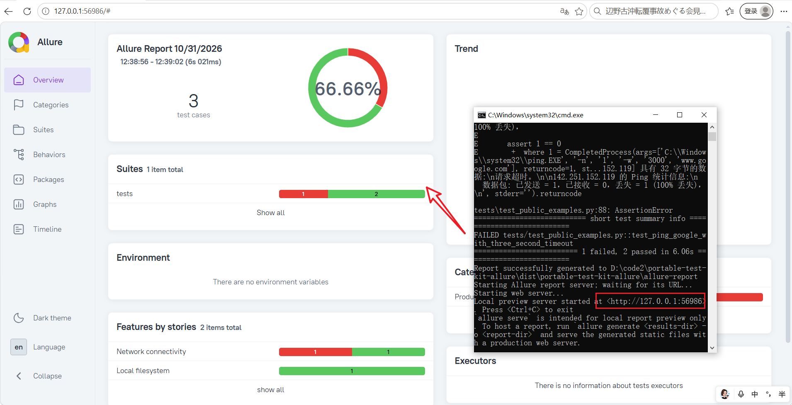

<p align="center">
    <a href="./README-EN.md">English</a> ·
    <strong>简体中文</strong>
</p>

# 便携式 Python+Pytest+Allure 测试环境

本项目用于构建 Windows x64 便携测试包。
运行时只需复制本文件夹，无需安装python, jre, allure 等。
方便离线和快速验证。
交付包内含 WinPython、锁定的 pytest 依赖、Allure CLI 2.46.1 和 Eclipse Temurin JRE 21.0.12.1+1。

| 项目 | 说明 |
| --- | --- |
| 目标设备依赖 | Windows x64、`ping.exe`、可读的 `C:\` 根目录和系统默认浏览器 |
| 包内运行时 | 已包含 Python 和 Java，目标设备无需另行安装 Python、Java 或 uv |
| 网络要求 | 构建时需要下载组件；ping 用例需要出站 ICMP；报告生成不需要联网 |
| 示例测试 | `test_public_examples.py`：ping 百度、ping Google（3 秒超时）、列出 `C:\` 根目录 |

## 运行示例
只需要双击运行 run-tests.cmd 即可，报告会自动打开


演示视频：[portable-test-kit-allure 操作演示视频](assets/portable-test-kit-allure_demo_video.mp4)

## 操作流程

1. 在构建机上[构建交付包](#构建交付包)。
2. 将 `dist\portable-test-kit-allure` 复制到目标设备并[运行测试](#在目标设备运行)。
3. 如需扩充测试，按[编写与筛选测试](#编写与筛选测试)修改源码并重新构建。
4. 使用[交付包验收](#验证交付包)检查构建结果。

## 构建交付包

### 构建机要求

使用可联网的 Windows x64 构建机，并在仓库根目录执行以下命令：

```powershell
.\tools\portable-test-env\build.ps1
```

构建脚本从清单指定的位置下载 Python、Allure CLI 和 Temurin JRE 归档，并逐一校验 SHA-256；锁定的 pytest wheels 下载后会离线安装到包内。交付目录为仓库根目录下的 `dist\portable-test-kit-allure`。

如果交付目录已存在，构建默认拒绝覆盖。确认需要替换时，显式添加 `-Force`：

```powershell
.\tools\portable-test-env\build.ps1 -Force
```

### 使用本地缓存

如果归档和 wheelhouse 已经下载到本地，可传入路径，避免重新下载：

```powershell
.\tools\portable-test-env\build.ps1 `
  -RuntimeArchivePath "C:\cache\WinPython64-3.13.18.0dot.zip" `
  -WheelhousePath "C:\cache\pytest-wheels" `
  -AllureArchivePath "C:\cache\allure-2.46.1.zip" `
  -JavaRuntimeArchivePath "C:\cache\OpenJDK21U-jre_x64_windows_hotspot_21.0.12.1_1.zip"
```

仅检查构建元数据及已传入归档的 SHA-256，不下载文件，也不写入交付目录：

```powershell
.\tools\portable-test-env\build.ps1 -ValidateOnly
```

## 在目标设备运行

将交付目录复制到目标设备的当前用户可写位置。打开 PowerShell 或命令提示符，在交付目录中运行：

```powershell
.\run-tests.cmd
```

### 示例测试

当前示例位于 `tests\test_public_examples.py`：

| 用例 | 内容 |
| --- | --- |
| `test_ping_baidu` | ping `www.baidu.com`，检查退出码和 `TTL=` |
| `test_ping_google_with_three_second_timeout` | ping `www.google.com`，单次回复超时和进程超时均为 3 秒 |
| `test_list_c_drive_root_directory` | 列出 `C:\` 根目录，检查目录非空且包含 `Windows` |

运行 ping 用例需要出站 ICMP。Google 在部分网络中会被拦截，此时该用例失败并保留 ping 输出，不影响 C 盘用例。示例不需要管理员权限，不修改文件或系统配置。

### 运行结果与日志

每次运行会清理上次运行的托管结果，然后执行 pytest 并生成 Allure 报告。即使 pytest 有失败用例，启动器也会尝试生成并打开报告。

| 文件或目录 | 内容 |
| --- | --- |
| `allure-results` | 本次 pytest 运行产生的 Allure 结果 |
| `allure-report` | 生成的 Allure 报告 |
| `logs\pytest.log` | pytest 输出 |
| `logs\allure-generate.log` | Allure 报告生成日志 |
| `logs\allure-open.log` | Allure 报告启动日志 |

| 情况 | 启动器退出码 |
| --- | --- |
| pytest 运行 | 返回 pytest 退出码 |
| pytest 成功，但报告生成或启动失败 | 返回非零退出码 |

Allure CLI 会自动打开系统默认浏览器，并在 `127.0.0.1` 上启动临时报告服务，不监听外部网络接口。查看报告期间请保持终端打开；按 `Ctrl+C` 停止服务。下一次运行会清理并重新生成报告。

## 编写与筛选测试

### Python 依赖包

当前由项目依赖文件管理的 Python 包如下。`requirements.in` 中列出直接依赖，`requirements.lock` 固定完整依赖树的版本和 SHA-256 哈希。

| 类型 | 包 | 版本 |
| --- | --- | --- |
| 直接依赖 | `pytest` | `8.3.2` |
| 直接依赖 | `allure-pytest` | `2.16.2` |
| 传递依赖 | `allure-python-commons` | `2.16.2` |
| 传递依赖 | `attrs` | `26.1.0` |
| 传递依赖 | `colorama` | `0.4.6` |
| 传递依赖 | `iniconfig` | `2.3.1` |
| 传递依赖 | `packaging` | `26.3` |
| 传递依赖 | `pluggy` | `1.7.0` |

Allure CLI 和 Java JRE 是单独下载、打包的运行时，不是 Python 包，不要添加到 `requirements.in`。

新增 Python 依赖时，按以下步骤更新：

1. 在 `tools\portable-test-env\requirements.in` 中添加并固定直接依赖版本，例如：

  ```text
  some-package==1.2.3
  ```

2. 使用项目配置好的 `pip-tools` 环境重新生成锁文件。当前 `requirements.lock` 记录的命令为：

  ```powershell
  pip-compile --generate-hashes --no-index --output-file='tools\portable-test-env\requirements.lock' --strip-extras 'tools\portable-test-env\requirements.in'
  ```

  不要手工编辑锁文件。生成后检查新包及其传递依赖都已锁定版本和哈希，并且有兼容包内 Python 3.13、Windows x64 的 wheel；构建只下载 wheel，不会安装源码包。

3. 如测试代码使用了新包，添加或更新相应测试，然后从仓库根目录重新构建：

  ```powershell
  .\tools\portable-test-env\build.ps1 -Force
  ```

  `-Force` 用于替换已有交付目录。构建完成后，进入生成的交付目录运行验收脚本：

  ```powershell
  .\validate-bundle.ps1
  ```

  目标设备运行测试时使用包内依赖，无需下载依赖；ping 用例仍需要出站 ICMP。

### 添加或修改用例

在源码目录 `tools\portable-test-env\tests\` 下创建或修改 `test_*.py` 文件，测试函数名以 `test_` 开头。多个测试共用的 fixture、命令行选项和测试配置放在 `tests\conftest.py`。修改源码后需要重新构建，交付包才会包含更新后的用例。

默认运行范围由源码 `tools\portable-test-env\run_tests.py` 中 pytest 命令的 `"tests"` 参数决定。通常无需修改；`run-tests.cmd` 会将后续参数原样传给 pytest。

### 选择运行范围

| 参数 | 用途 | 示例 |
| --- | --- | --- |
| `-k` | 按测试名称或表达式筛选 | `-k "ping_baidu"` |
| `-m` | 按 marker 筛选 | `-m "smoke"` |

在交付目录运行示例：

```powershell
.\run-tests.cmd -k "ping_baidu"
.\run-tests.cmd -m "smoke"
```

`-k` 和 `-m` 的表达式语法与 pytest 一致。当前示例测试没有自定义 marker；使用自定义 marker 时，应在 pytest 配置中注册，避免未知 marker 警告。

如果要固定默认运行范围为某个文件或测试函数，修改 `run_tests.py` 中的 `"tests"` 参数，例如：

```text
tests\test_public_examples.py
```

修改后重新构建交付包。

## 验证交付包

在目标设备的交付目录中运行：

```powershell
.\validate-bundle.ps1
```

验收脚本会检查必要文件、清单哈希、包内 Python、pytest、Allure CLI 和 Java 版本，并收集测试。它不会修改系统环境变量或注册表，不会安装服务，也不会访问网络。

## 第三方组件

组件版本、下载地址、归档 SHA-256 和许可证信息以 `bundle-manifest.json` 与 `THIRD_PARTY_NOTICES.md` 为准。构建过程只接受 SHA-256 与清单匹配的归档。
